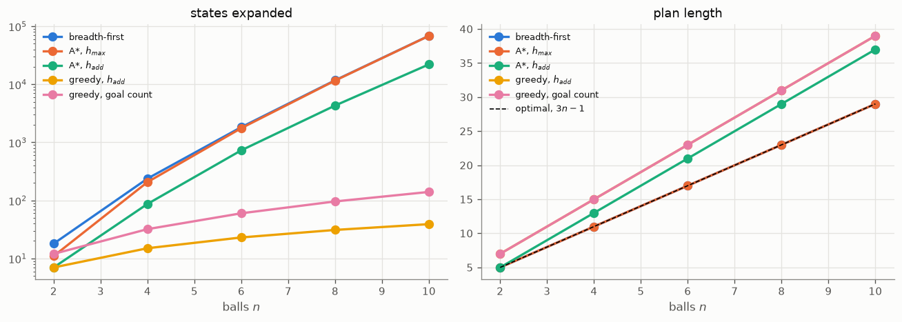

# 10 · Task planning

A behaviour tree (chapter 9) executes decision logic that someone wrote by hand. When the right *order* of
actions depends on the situation — which box to move first, where to put one down to free a stand — writing every
case by hand stops scaling. **Task planning** lets the robot work the order out itself: describe what each action
needs and what it changes, state the goal, and search for a sequence that gets there. This chapter covers the
classical formulation (STRIPS) [6], the language it is written in (PDDL), how a planner turns it into a search
problem, and the heuristics that make that search fast.

Code: [`task_planning.hpp`](../cpp/include/motion_planning/task_planning.hpp) ·
Tests: [`test_task_planning.cpp`](../cpp/tests/test_task_planning.cpp) ·
Domains: [`python/motion_planning/pddl/`](../python/motion_planning/pddl) ·
Notebook: [`10_task_planning.ipynb`](../2_notebooks/exercises/10_task_planning.ipynb)

## 10.1 States as sets of facts

STRIPS [1] describes the world by **facts**, ground atoms such as `(on a b)` or `(robot-at kitchen)`. A state is
the set of facts that are true in it; every other fact is false (the *closed-world* assumption). A planning task
is

$$
\Pi = \langle F, A, I, G \rangle, \qquad s \subseteq F, \quad I \subseteq F, \tag{10.1}
$$

with $F$ the facts, $A$ the actions, $I$ the initial state and $G$ the goal: facts that must be true (and, with
negative goals, facts that must be false). A goal is a *partial* description — any state that satisfies it will
do.

## 10.2 Actions

An action $a$ has a precondition (facts that must be true, $\mathrm{pre}^+(a)$, and facts that must be false,
$\mathrm{pre}^-(a)$), an add list, a delete list and a cost:

$$
a = \langle \mathrm{pre}^+(a), \mathrm{pre}^-(a), \mathrm{add}(a), \mathrm{del}(a), c(a) \rangle . \tag{10.2}
$$

It is **applicable** in $s$ if

$$
\mathrm{pre}^+(a) \subseteq s \quad\text{and}\quad \mathrm{pre}^-(a) \cap s = \emptyset, \tag{10.3}
$$

and applying it gives the **progression**

$$
s' = \big(s \setminus \mathrm{del}(a)\big) \cup \mathrm{add}(a). \tag{10.4}
$$

Deletes are applied first, so a fact both deleted and added ends up true. A **plan** is a sequence of actions,
each applicable in the state its predecessors produce, ending in a state that satisfies $G$. Its cost is the sum
of the action costs; here every action costs 1, so cost = length.

Nothing else changes: facts not mentioned by an action keep their value. This *frame assumption* is what makes
STRIPS compact — and what makes a forgotten delete effect dangerous (section 10.7).

## 10.3 PDDL and grounding

Writing one action per combination of objects is impractical, so actions are written as **schemas** with typed
parameters, in the Planning Domain Definition Language [2]. A *domain* file holds the types, predicates and
schemas; a *problem* file the objects, the initial state and the goal. The pick-and-place domain of this chapter:

```lisp
(:action place
  :parameters (?b - box ?s - stand ?p - place)
  :precondition (and (robot-at ?p) (stand-at ?s ?p) (holding ?b) (not (occupied ?s)))
  :effect (and (on ?b ?s) (occupied ?s) (gripper-free) (not (holding ?b))))
```

**Grounding** substitutes objects for the parameters in every type-correct way and produces the ground actions
(10.2). Two simplifications make it practical:

- **Static facts** — predicates that no action adds or deletes (`stand-at`, `connected`, and in the untyped
  Gripper domain `ball`, `room`, `gripper`) never change. They are evaluated once against $I$ and are not state
  variables; an action whose static precondition is false is dropped.
- **Early pruning** — a static literal is checked as soon as its last parameter is bound, so whole subtrees of
  bindings are skipped.

In Gripper with $n$ balls, two rooms and two grippers, the untyped domain allows $(n+4)^2$ bindings of `move` and
$(n+4)^3$ of `pick` and of `drop`; static pruning keeps $4 + 8n$ actions. The test checks these counts.

The parser accepts the STRIPS subset: `:strips`, `:typing`, `:negative-preconditions`; conjunctions of literals in
preconditions, effects and goals. Disjunctions, quantifiers, conditional effects and numbers are rejected with a
message rather than misread.

## 10.4 Forward search

The ground task is a graph: states are vertices, applicable actions are edges (10.3, 10.4). Any graph search of
chapter 4 applies, with two differences — the graph is not given but generated on the fly, and it is
astronomically large ($2^{|F|}$ potential states). The planners here are **graph searches** with duplicate
detection:

- **Breadth-first** — optimal in the number of actions. The goal is tested when a state is *generated*, so the
  first goal found is at minimal depth.
- **A\*** — expand the state with the least

$$
f(s) = g(s) + w\,h(s), \tag{10.5}
$$

  $g$ the cost so far and $h$ an estimate of the cost to go. With $w = 1$ and an admissible $h$ the plan is
  optimal; states reached again more cheaply are re-opened.
- **Greedy best-first** — expand by the estimate alone,

$$
f(s) = h(s), \tag{10.6}
$$

  fast and without any optimality guarantee.

## 10.5 Heuristics from relaxations

A heuristic should be cheap and informative. The simplest is the **goal count**,

$$
h_{gc}(s) = \big|\{g \in G^+ : g \notin s\}\big| + \big|\{g \in G^- : g \in s\}\big|, \tag{10.7}
$$

which is not admissible (one action can achieve two goals). Better heuristics come from a **relaxation**: ignore
all delete lists. In the relaxed problem facts only accumulate, so the cost of reaching each fact can be computed by
a fixpoint iteration from $s$ [3]:

$$
c(f; s) = \begin{cases} 0 & f \in s \\[2pt]
\displaystyle\min_{a:\ f \in \mathrm{add}(a)} \Big[ c(a) + \underset{p \in \mathrm{pre}^+(a)}{\mathrm{agg}}\ c(p; s) \Big] & \text{otherwise.}
\end{cases} \tag{10.8}
$$

With $\mathrm{agg} = \max$ — the most expensive precondition — and the goal combined the same way,

$$
h_{max}(s) = \max_{g \in G^+} c(g; s), \tag{10.9}
$$

and with $\mathrm{agg} = \sum$ — every precondition paid for separately —

$$
h_{add}(s) = \sum_{g \in G^+} c(g; s). \tag{10.10}
$$

$h_{max}$ is **admissible**,

$$
h_{max}(s) \le h^*(s), \tag{10.11}
$$

because any real plan contains, for the most expensive goal, a chain of achievers at least as long as the
relaxation's cheapest one. $h_{add}$ assumes goals and preconditions share nothing and overestimates, but it
measures how much work is left far better. Both are $\infty$ when even the relaxation cannot reach the goal — a
**dead end**, which the planner prunes. Negative preconditions and goals are ignored by the relaxation (they can
only make the real problem harder, so admissibility is kept).

**Worked example — the Sussman anomaly** [4]. C is on A, B on the table; the goal is A on B on C. Achieving
`(on a b)` first buries C; achieving `(on b c)` first leaves A under C — each goal has to be undone to reach the
other, so the plan must interleave them [7]: unstack C from A, put C down, pick up B, stack B on C, pick up A, stack A
on B — **6** actions. With 19 facts and 24 ground actions, breadth-first search expands 18 states; A\* with
$h_{max}$ ($h_{max}(I) = 3$) expands 10.

## 10.6 How the heuristics behave

**Gripper** [5] (Figure 10.1): $n$ balls in room A go to room B; the robot has two grippers. The optimal plan
carries two balls per round trip: pick, pick, move, drop, drop, move back — $3n - 1$ actions. The test checks
$n = 2, 4, 6$ against this formula.

| $n$ | facts | actions | breadth-first | A\*, $h_{max}$ | A\*, $h_{add}$ | greedy, $h_{add}$ | greedy, goal count |
|---|---|---|---|---|---|---|---|
| 2 | 12 | 20 | 5 / 18 | 5 / 11 | 5 / 7 | 7 / 7 | 7 / 12 |
| 4 | 20 | 36 | 11 / 238 | 11 / 207 | 13 / 87 | 15 / 15 | 15 / 32 |
| 6 | 28 | 52 | 17 / 1830 | 17 / 1759 | 21 / 730 | 23 / 23 | 23 / 60 |
| 8 | 36 | 68 | 23 / 11742 | 23 / 11615 | 29 / 4313 | 31 / 31 | 31 / 96 |
| 10 | 44 | 84 | 29 / 68566 | 29 / 68367 | 37 / 22068 | 39 / 39 | 39 / 140 |

*Plan length / states expanded.*

- $h_{max}(I) = 2$ for every $n$: the most expensive single ball needs a pick and a drop (the move is shared in the
  relaxation). So A\* with $h_{max}$ is optimal but barely better than blind search — 68 367 against 68 566
  expansions at $n = 10$. Admissible heuristics that look at one goal at a time are weak when the difficulty is
  the *number* of goals.
- $h_{add}(I) = 3n$: each ball counted as pick + move + drop. It overestimates, so A\* with $h_{add}$ loses
  optimality ($37$ instead of $29$) but expands three times fewer states.
- Greedy search with $h_{add}$ expands exactly one state per plan step — it never backtracks — and returns
  $4n - 1$ actions: it carries one ball at a time, because $h_{add}$ does not see that two balls can share a trip.

The two Blocksworld problems behave the same way: reversing a tower of five blocks (10 actions optimal) takes 95
expansions blind, 25 with A\* and $h_{max}$, and 10 with greedy $h_{add}$, which here also finds the optimal plan.



*Figure 10.1 — Gripper with $n$ balls. Left: states expanded (log scale). Right: plan length; the two greedy
planners produce plans of equal length, so one line hides the other. Generated by `tools/make_figures.py`.*

**The pick-and-place swap.** Two boxes on stands in two rooms must swap places; a third stand in the corridor
between them is the buffer. With 15 facts and 16 ground actions (static `stand-at` and `connected` pruned
everything else), every planner finds the optimal **13**-action plan: drive to room 1, pick red, drive to the
corridor, place it on the buffer, drive to room 2, pick blue, drive back through the corridor to room 1, place
blue, drive to the corridor, pick red, drive to room 2, place red. A behaviour tree written by hand would have to
contain this ordering; the planner derives it from the action models.

## 10.7 Algorithm

**Planning a PDDL problem** (`parse_domain`, `parse_problem`, `ground`, `plan`):

1. Parse the domain and the problem; find the static predicates.
2. Ground every schema over the type-correct bindings, pruning by static literals (10.3); intern the fluent facts
   as bit indices; build $I$ and $G$.
3. Search forward from $I$: breadth-first, or a best-first search ordered by (10.5) or (10.6), computing
   $h$ by (10.7)–(10.10) for every new state and dropping states with $h = \infty$.
4. Return the plan; check it independently by replaying it with (10.3)–(10.4) (`validate_plan`).

## 10.8 Common mistakes

- **Forgetting a delete effect.** The frame assumption then keeps the fact true: a `drive` that does not delete
  `(robot-at ?from)` puts the robot in two places, and plans become impossibly short. Validate plans against the
  intended model, and test the domain on small problems by hand.
- **Using an inadmissible heuristic and expecting optimal plans.** A\* with $h_{add}$ or the goal count is not
  optimal (37 instead of 29 actions on Gripper with ten balls).
- **Expecting an admissible heuristic to be fast.** $h_{max}$ saved 0.3 % of the expansions on Gripper.
- **Typing objects in the problem but not using types in the domain** (or the other way round): every binding is
  then legal and grounding produces nonsense actions such as picking up a room.
- **Treating the plan as the controller.** A plan is open-loop; the robot executes it with feedback (task-priority
  control, behaviour trees) and replans when the world disagrees with the model.

## References

1. R. E. Fikes, N. J. Nilsson, "STRIPS: a new approach to the application of theorem proving to problem solving",
   *Artificial Intelligence* 2(3–4):189–208, 1971.
2. D. McDermott et al., "PDDL — the Planning Domain Definition Language", Tech. Rep. CVC TR-98-003, Yale, 1998.
3. B. Bonet, H. Geffner, "Planning as heuristic search", *Artificial Intelligence* 129(1–2):5–33, 2001.
4. G. J. Sussman, *A Computational Model of Skill Acquisition*, PhD thesis, MIT, 1973.
5. D. McDermott, "The 1998 AI planning systems competition", *AI Magazine* 21(2):35–55, 2000.
6. M. Ghallab, D. Nau, P. Traverso, *Automated Planning and Acting*, Cambridge University Press, 2016, ch. 2.
7. S. Russell, P. Norvig, *Artificial Intelligence: A Modern Approach*, 4th ed., Pearson, 2020, ch. 11.
