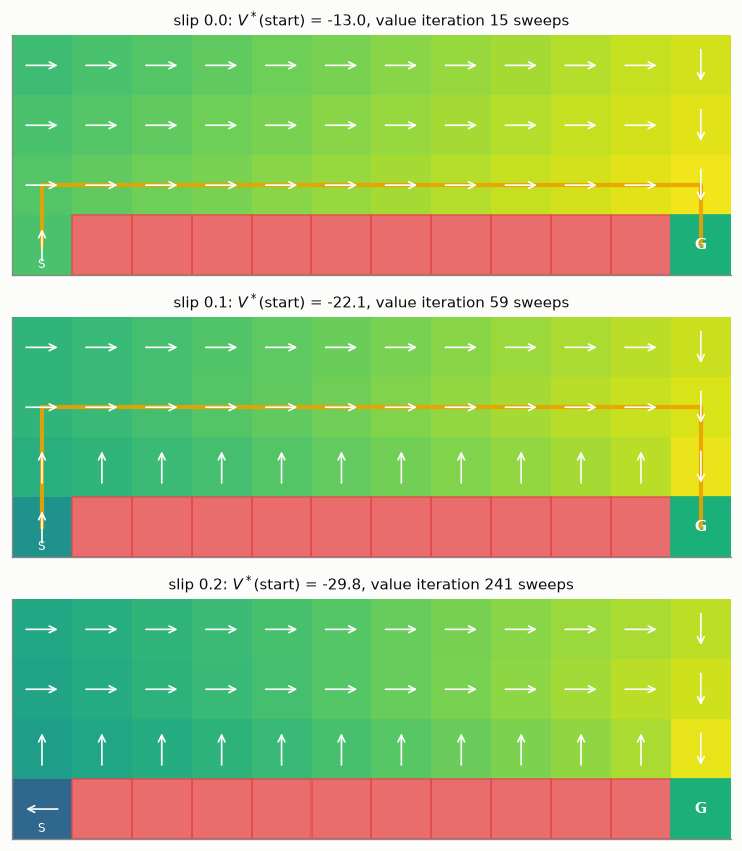
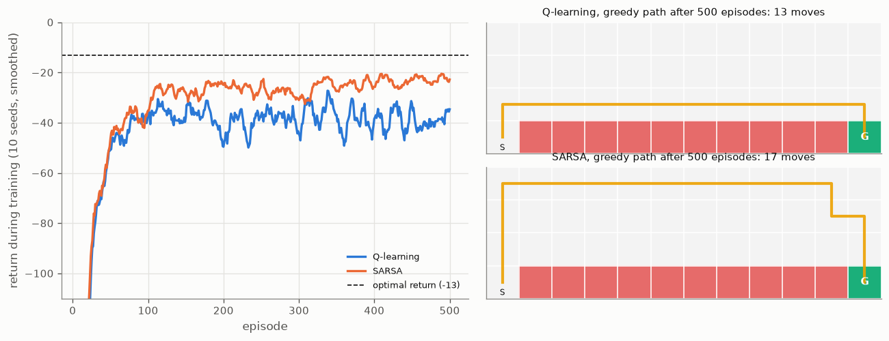

# 11 · Reinforcement learning basics

Chapters 4–10 assumed that the robot *knows* its model: the map, the effect of each action, the cost of each step.
When outcomes are uncertain — a wheel slips, a grasp sometimes fails — the planner has to reason about
probabilities, and when the model is unknown altogether the robot has to *learn* what its actions do from
experience. This chapter introduces the framework for both, the **Markov decision process**; solves it when the
model is known (value iteration, policy iteration); and learns it from trial and error when it is not (Q-learning,
SARSA), on grid worlds where every number can be checked.

Code: [`reinforcement.hpp`](../cpp/include/motion_planning/reinforcement.hpp) ·
Tests: [`test_reinforcement.cpp`](../cpp/tests/test_reinforcement.cpp) ·
Notebook: [`11_reinforcement_learning.ipynb`](../2_notebooks/exercises/11_reinforcement_learning.ipynb)

## 11.1 Markov decision processes

A finite MDP [1] is

$$
\mathcal{M} = \langle S, A, P, R, \gamma \rangle, \qquad P(s' \mid s, a),\ R(s, a, s'), \tag{11.1}
$$

finite sets of states and actions, transition probabilities, rewards, and a discount factor $\gamma \in [0, 1]$.
The **Markov property** says that $P$ depends only on the current state and action, not on the history. Some states
are **terminal**: the episode ends there, and their value is 0.

**Grid worlds.** The examples are grids of cells: four moves (up, right, down, left); walls and the border block a
move; every move earns $-1$; entering a goal ends the episode, entering a pit (the cliff) ends it with an extra
$-100$. With **slip** $p$, the intended move happens with probability $1 - p$ and each perpendicular move with $p/2$
— a simple model of wheels on a slippery floor.

## 11.2 Returns, policies, values

The agent collects the **return**

$$
G_t = \sum_{k=0}^{\infty} \gamma^k\, r_{t+k+1}, \tag{11.2}
$$

$\gamma < 1$ weighting near rewards more than far ones (and keeping the sum finite); with episodes that surely end,
$\gamma = 1$ is fine. A **policy** $\pi(s)$ chooses an action in every state. Its **value** $V^\pi(s)$ is the
expected return from $s$ when following $\pi$; it satisfies the Bellman expectation equation — one equation per
state, linear in $V^\pi$:

$$
V^\pi(s) = \sum_{s'} P(s' \mid s, \pi(s))\,\big[R + \gamma V^\pi(s')\big]
\quad\Longleftrightarrow\quad (I - \gamma P_\pi)\,V^\pi = r_\pi . \tag{11.3}
$$

The **action value** of taking $a$ once and then following values $V$ is

$$
Q(s, a) = \sum_{s'} P(s' \mid s, a)\,\big[R(s, a, s') + \gamma V(s')\big], \tag{11.4}
$$

and the **greedy** policy with respect to $V$ picks the best of them:

$$
\pi(s) = \arg\max_a Q(s, a). \tag{11.5}
$$

## 11.3 Value iteration

The optimal values satisfy the Bellman **optimality** equation $V^*(s) = \max_a Q^*(s, a)$. Value iteration [2]
turns it into an update, applied to every state in sweeps until nothing changes:

$$
V_{k+1}(s) = \max_a \sum_{s'} P(s' \mid s, a)\,\big[R + \gamma V_k(s')\big]. \tag{11.6}
$$

The update $T$ is a **contraction** in the max norm,

$$
\lVert TV - TV' \rVert_\infty \le \gamma\, \lVert V - V' \rVert_\infty, \tag{11.7}
$$

so $V_k \to V^*$ from any start, and the change per sweep shrinks at least by $\gamma$; the test checks this on every
sweep. With $\gamma = 1$ it still converges when every policy ends the episode (or when the bad ones are penalised
enough). The greedy policy of $V^*$ is optimal.

**Worked example.** In a deterministic grid with reward $-1$ per move, the value of a cell is the negative of a
discounted step count: if the goal is $d$ moves away,

$$
V^*(s) = -\sum_{k=0}^{d-1} \gamma^k = -\frac{1 - \gamma^d}{1 - \gamma} \quad (\gamma < 1), \qquad V^*(s) = -d \quad (\gamma = 1). \tag{11.11}
$$

The test computes $d$ by breadth-first search (chapter 4) and checks (11.11) for every cell of a 5 × 10 room with
walls: from the start, 11 moves away, $V^* = -11$ for $\gamma = 1$ and $-6.862$ for $\gamma = 0.9$; value iteration
converges in 14 sweeps.

## 11.4 Policy iteration

Policy iteration [3] alternates two steps until the policy stops changing: **evaluate** the current policy exactly,
by solving the linear system (11.3); **improve** it greedily by (11.5). Each improvement step yields a policy at
least as good, and there are finitely many policies, so it terminates — usually after very few steps, because each
evaluation is exact. On the same room with slip 0.2, a goal reward of 10 and $\gamma = 0.95$, value iteration needs
65 sweeps to reach a change below $10^{-12}$ and policy iteration 6 improvement steps; both give the same values to
$10^{-8}$. Each policy-iteration step solves a linear system of the size of the state space, so for large problems the
cheap sweeps of value iteration win.

## 11.5 Uncertainty changes the optimal path

The **cliff** (Figure 11.1): a 4 × 12 grid, start bottom left, goal bottom right, and the bottom row in between a
cliff. Without slip the optimal path walks right along the edge: 13 moves, $V^*(\text{start}) = -13$. With slip
0.1, each step along the edge risks falling with probability 0.05, and the optimal policy keeps one row away: 15
moves on the most likely path, $V^*(\text{start}) = -22.1$. With slip 0.2 the policy at the start is to push **left
into the wall**: the agent stays put with probability 0.9 (the downward slip hits the border too) and drifts up,
away from the cliff, with probability 0.1 —
waiting is cheaper than a 10 % chance of falling. $V^*(\text{start}) = -29.8$. The value of the model is visible here:
the same planner gives a bold or a cautious robot depending on how well it can move.

*Figure 11.1 — Value iteration ($\gamma = 1$) on the cliff with slip 0, 0.1 and 0.2: optimal values (colour),
policy (arrows) and the most likely path (orange). Generated by `tools/make_figures.py`.*

## 11.6 Learning without a model: TD control

Without $P$ and $R$, the agent can still learn by acting: take an action, observe the reward and the next state,
and nudge an estimate of $Q$ towards what it saw. **Temporal-difference** methods [4] update after every step,

$$
Q(s, a) \leftarrow Q(s, a) + \alpha\,\big[\,\text{target} - Q(s, a)\,\big], \tag{11.8}
$$

with learning rate $\alpha$. They differ in the target:

$$
\text{Q-learning [5]:}\quad r + \gamma \max_{a'} Q(s', a'), \qquad
\text{SARSA:}\quad r + \gamma\, Q(s', a'_{\text{taken}}). \tag{11.9}
$$

Q-learning is **off-policy**: its target assumes the agent will act greedily from $s'$, whatever it actually does;
it learns $Q^*$. SARSA is **on-policy**: its target uses the action the agent really takes next, so it learns the
value of the policy it follows — exploration included. Both explore with an **ε-greedy** behaviour policy,

$$
a = \begin{cases} \text{random action} & \text{with probability } \varepsilon \\ \arg\max_a Q(s, a) & \text{otherwise.} \end{cases} \tag{11.10}
$$

On the 5 × 10 room, Q-learning ($\alpha = 0.5$, $\varepsilon = 0.2$, 400 episodes) learns a greedy policy that reaches
the goal in the optimal 11 moves, with $\max_a Q(\text{start}, a)$ within $10^{-3}$ of $V^* = -11$.

**Q-learning against SARSA on the cliff** [4, example 6.6] (Figure 11.2, $\alpha = 0.5$, $\varepsilon = 0.1$, $\gamma = 1$, 500
episodes): Q-learning's greedy policy is the optimal edge path (13 moves); SARSA's keeps to the top row (17 moves).
Yet during training SARSA earns more — over the last 100 episodes an average return of $-23.8$ against $-39.0$ for
Q-learning (seed 7) — because Q-learning *walks* the edge while still exploring, and ε-greedy steps push it off.
Which is right depends on whether the robot will keep exploring when it is deployed.

*Figure 11.2 — Left: return per training episode, mean of 10 seeds, smoothed over 10 episodes. Right: greedy paths
after 500 episodes (seed 7). Generated by `tools/make_figures.py`.*

**Algorithm (TD control, `td_control`).**

1. Initialise $Q = 0$.
2. For each episode: $s \leftarrow$ start; choose $a$ ε-greedily (11.10).
3. Repeat: take $a$, observe $r$, $s'$. If $s'$ is terminal, target $= r$; else choose $a'$ ε-greedily and form the
   target by (11.9). Update (11.8). $s \leftarrow s'$, $a \leftarrow a'$. Until $s$ is terminal.

## 11.7 Where this sits in robotics

Tabular methods need a state space small enough to list (the MDPs of robot navigation under uncertainty are
treated at length in [6]) — a grid of cells, a handful of symbolic situations. They
are the foundation of the methods that scale (function approximation, deep RL), and they already answer the robotics
questions of this module: how much caution a slippery floor deserves (11.5), and how a robot can improve a behaviour
it has no model of (11.6). In practice a robot learns in simulation first; the cliff shows why — in the 500 training episodes of
Figure 11.2 (seed 7) Q-learning fell off it 139 times and SARSA 40 times.

## 11.8 Common mistakes

- **$\gamma = 1$ with policies that never end.** The values diverge (and the linear system (11.3) is singular): use
  $\gamma < 1$ or make sure every policy terminates. `evaluate_policy` reports it.
- **Confusing the behaviour policy with the learned one.** Q-learning's greedy policy is optimal; the returns it
  *collects* while exploring are not (Figure 11.2).
- **Relying on luck to explore.** On the cliff, $\varepsilon = 0$ happens to work: $Q$ starts at 0 and every reward is
  negative, so untried actions look better than tried ones (*optimistic* initial values [4, sec. 2.6]) and the greedy
  agent still learns the 13-move path, falling 11 times in 500 episodes ($\varepsilon = 0.1$: 139, $\varepsilon = 0.3$:
  303). Where untried actions look worse — positive rewards, $Q$ initialised low — a greedy agent keeps repeating its
  first success. Choose the exploration on purpose.
- **A learning rate that never decreases on a stochastic problem.** With constant $\alpha$, $Q$ keeps fluctuating
  around its target; convergence proofs need $\sum \alpha = \infty$, $\sum \alpha^2 < \infty$.
- **Reward shaping that changes the task.** A reward for being near the goal can make circling near it worth more
  than arriving.

## References

1. M. L. Puterman, *Markov Decision Processes: Discrete Stochastic Dynamic Programming*, Wiley, 1994.
2. R. Bellman, *Dynamic Programming*, Princeton University Press, 1957.
3. R. A. Howard, *Dynamic Programming and Markov Processes*, MIT Press, 1960.
4. R. S. Sutton, A. G. Barto, *Reinforcement Learning: An Introduction*, 2nd ed., MIT Press, 2018, ch. 3, 4 and 6.
5. C. J. C. H. Watkins, P. Dayan, "Q-learning", *Machine Learning* 8:279–292, 1992.
6. S. Thrun, W. Burgard, D. Fox, *Probabilistic Robotics*, MIT Press, 2005, ch. 14.

*Acknowledgement: this chapter grew out of joint work with Gebrecherkos Gebreslassie.*
