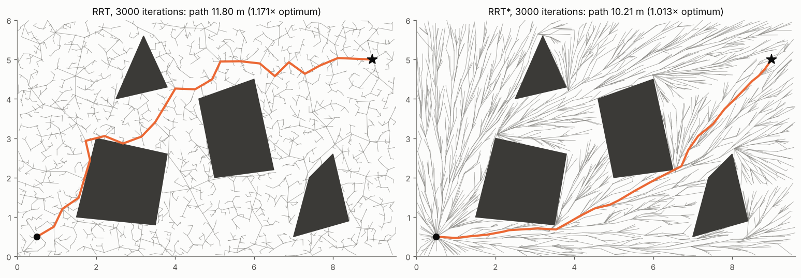

# learn-motion-planning

Motion planning from robot models to paths, then from paths to decisions: vehicle kinematics, configuration
space, potential fields, graph search, sampling-based planners, Dubins paths, path tracking, local planning,
behaviour trees, task planning and reinforcement learning. Each chapter has a theory text, a C++17 library
(`motion_planning`) tested against independent references, and Python notebooks that call it.



*Chapter 5: RRT and RRT* after 3000 iterations; RRT* converges towards the shortest path.*

## Chapters

| # | Chapter | Theory | Code | Notebook |
|---|---------|--------|------|----------|
| 1 | Vehicle kinematic models | [text](1_theory/01_vehicle_kinematics.md) | [kinematics.hpp](cpp/include/motion_planning/kinematics.hpp) · [pose_control.hpp](cpp/include/motion_planning/pose_control.hpp) | [exercises](2_notebooks/exercises/01_vehicle_kinematics.ipynb) · [solutions](2_notebooks/solutions/01_vehicle_kinematics.ipynb) |
| 2 | Configuration space and occupancy grids | [text](1_theory/02_configuration_space.md) | [grid.hpp](cpp/include/motion_planning/grid.hpp) | [exercises](2_notebooks/exercises/02_configuration_space.ipynb) · [solutions](2_notebooks/solutions/02_configuration_space.ipynb) |
| 3 | Potential fields | [text](1_theory/03_potential_fields.md) | [potential.hpp](cpp/include/motion_planning/potential.hpp) | [exercises](2_notebooks/exercises/03_potential_fields.ipynb) · [solutions](2_notebooks/solutions/03_potential_fields.ipynb) |
| 4 | Graph search | [text](1_theory/04_graph_search.md) | [graph_search.hpp](cpp/include/motion_planning/graph_search.hpp) | [exercises](2_notebooks/exercises/04_graph_search.ipynb) · [solutions](2_notebooks/solutions/04_graph_search.ipynb) |
| 5 | Sampling-based planning | [text](1_theory/05_sampling_planning.md) | [sampling.hpp](cpp/include/motion_planning/sampling.hpp) | [exercises](2_notebooks/exercises/05_sampling_planning.ipynb) · [solutions](2_notebooks/solutions/05_sampling_planning.ipynb) |
| 6 | Non-holonomic paths | [text](1_theory/06_dubins_paths.md) | [dubins.hpp](cpp/include/motion_planning/dubins.hpp) | [exercises](2_notebooks/exercises/06_dubins_paths.ipynb) · [solutions](2_notebooks/solutions/06_dubins_paths.ipynb) |
| 7 | Path smoothing and tracking | [text](1_theory/07_smoothing_tracking.md) | [tracking.hpp](cpp/include/motion_planning/tracking.hpp) | [exercises](2_notebooks/exercises/07_smoothing_tracking.ipynb) · [solutions](2_notebooks/solutions/07_smoothing_tracking.ipynb) |
| 8 | Local planning | [text](1_theory/08_local_planning.md) | [dwa.hpp](cpp/include/motion_planning/dwa.hpp) | [exercises](2_notebooks/exercises/08_local_planning.ipynb) · [solutions](2_notebooks/solutions/08_local_planning.ipynb) |
| 9 | Behaviour trees | [text](1_theory/09_behavior_trees.md) | [behavior_tree.hpp](cpp/include/motion_planning/behavior_tree.hpp) | [exercises](2_notebooks/exercises/09_behavior_trees.ipynb) · [solutions](2_notebooks/solutions/09_behavior_trees.ipynb) |
| 10 | Task planning | [text](1_theory/10_task_planning.md) | [task_planning.hpp](cpp/include/motion_planning/task_planning.hpp) | [exercises](2_notebooks/exercises/10_task_planning.ipynb) · [solutions](2_notebooks/solutions/10_task_planning.ipynb) |
| 11 | Reinforcement learning basics | [text](1_theory/11_reinforcement_learning.md) | [reinforcement.hpp](cpp/include/motion_planning/reinforcement.hpp) | [exercises](2_notebooks/exercises/11_reinforcement_learning.ipynb) · [solutions](2_notebooks/solutions/11_reinforcement_learning.ipynb) |

Notation is fixed once in [1_theory/00_notation.md](1_theory/00_notation.md).

## Quick start

```bash
sudo apt install build-essential cmake libeigen3-dev python3-venv
make test                                   # C++ library and Catch2 tests
python3 -m venv .venv && source .venv/bin/activate
pip install -e ".[notebooks]"               # builds the Python module motion_planning (pybind11)
```

Then open `2_notebooks/exercises/` in Jupyter or VS Code: cells marked ✏️ are exercises with a check below them,
cells marked 🔨 break an assumption on purpose. Each notebook also runs on Colab (its first cell installs the
module). Details are in [HOW_TO_RUN.md](HOW_TO_RUN.md).

## Layout

```
1_theory/      chapter texts and figures
2_notebooks/   exercises/ (to fill in) and solutions/ (executed)
cpp/           include/motion_planning, src, tests (Catch2)
python/        bindings and helpers of the Python module motion_planning
tools/         figure generator and notebook tooling
```

## Used in

* [lidar-exploration](https://github.com/Rudip1/lidar-exploration) — frontier exploration in ROS 2 with Dubins RRT\* and pure
  pursuit from this library's C++ (chapters 5–7).
* [CA-MCW](https://github.com/Rudip1/CA-MCW) — an MPPI navigation controller with learned critic weights; chapter 8 covers
  the sampling-based local planners (dynamic window) it builds on.
* [robotics-learning](https://github.com/Rudip1/robotics-learning) — the umbrella of all learn-* modules.

## Licence

Code: Apache-2.0 ([LICENSE](LICENSE)). Theory texts and figures in `1_theory/`: CC BY 4.0.
